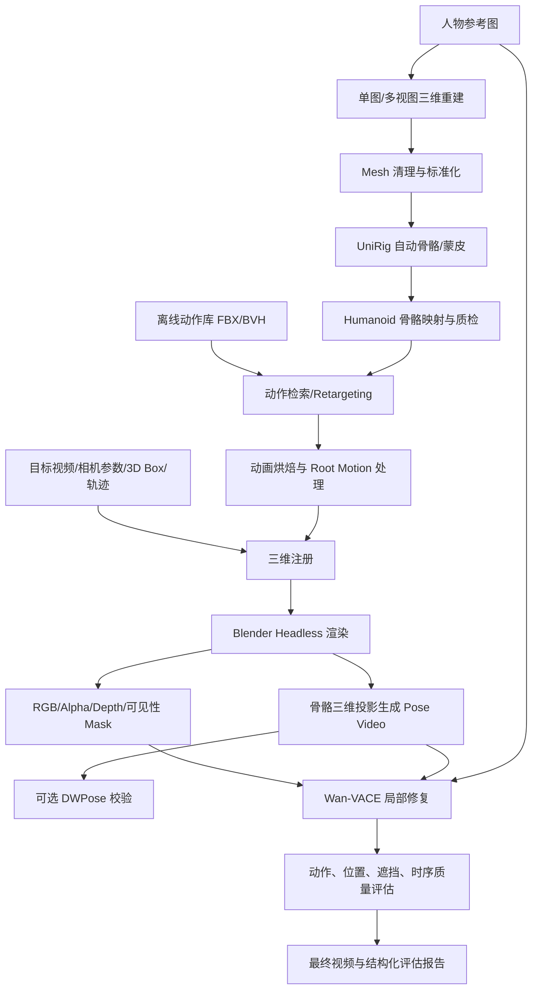

# AdamForge：动态人物资产注入与视频修复工作流

> 项目状态：技术方案 / 实施指导（非已完成系统）  
> 目标：将人物参考图转换为可动画的三维资产，通过离线动作库批量驱动，在给定相机和 3D Box 条件下准确注入视频，并使用 Wan-VACE 对局部视觉进行修复。

## 1. 总体架构



**原则：** 几何和动画由 Blender 确定；生成模型只修改允许修复的可见人物区域。DWPose 不再是必经环节，因为已有三维骨骼可直接投影至图像平面。VACE 的 Pose/参考图/Mask 组合需按实际实现适配，不假定它们可以作为完全独立的任意条件同时直接传入。

## 2. 端到端阶段

### 阶段 A：人物资产构建（每个人物只做一次）

**输入：** `reference.png`（或多视图）、可选 `mesh.glb`。  
**过程：**
1. 调用人物重建模块生成完整 Mesh 和纹理；尽量选择无遮挡、接近 T/A-Pose 的参考图。
2. Blender/Trimesh 完成坐标系和单位统一、朝向及原点归一、拓扑检查、非流形几何和游离片清理；必要时修补 Mesh。
3. 使用 UniRig 预测骨骼和蒙皮，合并回原 Mesh；保存中间结果以便重试。
4. 映射到项目统一的 Humanoid 关节定义，并检验关节拓扑、左右对称性、权重归一化和关节活动时的网格变形。
5. 保留失败案例在人工修复队列；通过者缓存为 `rigged_character.glb` 或 `rigged_character.fbx`。

**输出：** 标准化人物 Mesh、骨骼结构、蒙皮权重、身份参考图、资产元数据。

> UniRig 官方发布骨骼生成、蒙皮和合并三个阶段；自动推理不代表对任意重建人体都能一次成功。参见 https://github.com/VAST-AI-Research/UniRig 。

### 阶段 B：本地动作资产库与 Retargeting

**输入：** 标准化 Rig、动作库 `*.fbx` / `*.bvh`。  
**过程：**
1. 离线收集并整理 Idle、Walk、Run、Turn、Wave、Traffic-Control 等动作；登记授权、FPS、时长、骨骼规范、Root Motion 类型、是否可循环。
2. 对动作做一次性预处理：映射到标准 Humanoid 骨骼，统一姿态基准、局部骨骼轴向、单位、地面高度。
3. 新人物只执行目标骨骼适配和动作重定向；结合场景速度调整动作节奏，执行脚底接触约束与 IK 修正。
4. 将动画烘焙为确定性 FBX / Blender Action，保证 Headless 模式可复现。

**输出：** `animated.fbx`、动画元数据、动作质量报告。

**优化：** 尽量将重定向变成 `源动作 → 规范动作 → 目标骨骼`，避免每对骨骼分别编写映射。建议将人物骨骼原点与全局场景轨迹分开管理。

### 阶段 C：指定场景注册与渲染

**输入：** `animated.fbx`、相机内参 K、逐帧相机位姿、逐帧人物 Box 与轨迹、背景视频。

- **3D Box：** `(x,y,z,l,w,h,yaw)` 必须声明 XYZ 所处坐标系、中心/底部中心定义、LWH 与坐标轴关系、长度单位和旋转约定。
- **变换链：** `p_camera = T_camera_from_world(t) · T_world_from_actor(t) · p_actor`，再经 `K` 投影到像素；不要将 Waymo 的不同坐标系直接混用。
- **尺度：** 以人物静止姿态的身高与形体比例为主要约束；不应每帧为了强制匹配 Box 而拉伸肢体。对非均匀缩放设置阈值和异常标志。
- **Root Motion：** 区分动作内部位移与真实世界轨迹，防止位移叠加；行走速度、方向和脚底接触要协调。
- **输出：** 注册 RGB、人物 Alpha、Depth、ID Mask、与场景深度比较后得到的可见性 Mask，并保留相机元数据。

**遮挡原则：** 背景中的车辆、立柱等遮挡物应依赖已知场景几何/深度处理。没有可靠场景深度时记录遮挡不确定性，不声称已实现准确遮挡。

### 阶段 D：Pose 控制生成

**推荐路径：** 从 FBX/Blender 直接读取标准骨骼关节，使用同一相机逐帧投影，生成和输入视频严格对齐的 2D 关键点与可视化 `pose.mp4`。

**可选 DWPose：** 用于从外部真人动作视频提取 Pose 或对合成注册图进行姿态质量检测；若已知准确 Rig，则不必再次推理 DWPose。仅靠二维 Pose 不能表达完整深度和遮挡。

**输出：** `pose.json`（关键点及可见性）、`pose.mp4`（控制视频）。关键点拓扑与配色应与实际 VACE Pose 控制预处理保持一致。

### 阶段 E：Wan-VACE 局部修复

**目的：** 改善人物纹理、边缘、光照及融合，避免重新决定人物的 XYZ、尺度及动作。

**候选输入：** 参考人物图、背景及注册视频、可见人体编辑 Mask、Pose 视频、文本 Prompt。

**实施建议：**
1. 先验证 `registered video + edit mask` 的视频局部修复基线。
2. 再评估参考图对衣着/身份的稳定效果。
3. 最后试验 Pose 控制与编辑条件能否在所用 Wan-VACE 管线中同时生效；若接口不支持，分阶段生成或增加相应条件适配，不要将输入直接拼到未支持的参数中。
4. 锁定视频 FPS、帧序列、分辨率、随机种子和模型版本；按时间窗口推理时考虑重叠帧及跨窗口稳定性。
5. 尽量固定背景，仅在有充分依据的可见人物 Mask 及其小范围边缘区域内进行修复。

**输出：** `refined.mp4`，并保存未修复的 `registered.mp4` 用于对比。

### 阶段 F：自动评估与失败回退

- **几何偏差：** 生成的人物 2D Box 与注册投影 Box 的中心误差、宽高偏差、IoU。
- **姿态偏差：** 骨骼关键点距离 / PCK（仅对可见且可检测的关节）。
- **时序稳定性：** 闪烁、身份纹理漂移、关节抖动。
- **场景一致性：** 非编辑区像素差、遮挡顺序、脚地接触。
- **门控：** Rigging 不合格停止后续任务；VACE 修复使位置/姿态显著恶化时回退到已注册渲染版本。

## 3. 本地批处理与缓存

建议使用任务清单管理 `人物 × 动作 × 场景 × 轨迹` 组合：

```yaml
job_id: adam_0001
character:
  id: officer_001
  reference: assets/characters/officer_001/reference.png
  rigged_mesh: assets/characters/officer_001/rigged.glb
motion:
  id: traffic_stop
  source: assets/motions/traffic_police/stop_vehicle.fbx
  loop: false
scene:
  video: assets/scenes/scene_001/original.mp4
  camera: assets/scenes/scene_001/cameras.json
  boxes: assets/scenes/scene_001/boxes.json
  box_convention: bottom_center
  coordinate_system: world_meters
render:
  fps: 15
  width: 832
  height: 480
refinement:
  enabled: true
  pipeline: wan_vace
  mode: masked_video_edit
  use_pose_condition: false  # 按实现验证后再启用
output_dir: outputs/adam_0001
```

建议通过哈希缓存人物资产、动作规范化结果、注册参数、控制视频，任务失败时仅重跑失败阶段。使用 GPU 队列运行重建、UniRig、VACE；用独立 Blender Headless worker 执行重定向与渲染。每阶段记录运行版本、输入哈希、执行时间、GPU 消耗、状态和日志。

## 4. 建议项目目录

```text
adam-forge/
├── README.md
├── configs/
│   ├── pipeline.yaml
│   └── jobs/
├── adam_forge/
│   ├── reconstruction/
│   ├── rigging/
│   ├── motion_library/
│   ├── retargeting/
│   ├── registration/
│   ├── rendering/
│   ├── pose_control/
│   ├── refinement/
│   ├── evaluation/
│   └── orchestration/
├── blender_scripts/
├── assets/
│   ├── characters/
│   ├── motions/
│   └── scenes/
├── outputs/
├── tests/
└── docs/
```

`assets/` 中的人物/动作输入与大模型权重建议配置为外部存储路径，不应全部提交到 Git；仓库只保留代码、配置示例、少量可分发测试资产与相应许可证信息。

## 5. 参考命令（按工程阶段区分）

UniRig 官方脚本示例（需先按官方 README 安装依赖与模型）：

```bash
# 目录批量骨骼推理
bash launch/inference/generate_skeleton.sh \
  --input_dir /data/characters \
  --output_dir /data/skeletons

# 目录批量蒙皮推理
bash launch/inference/generate_skin.sh \
  --input_dir /data/skeletons \
  --output_dir /data/skinned
```

后续融合请使用官方 merge 脚本，注意蒙皮输出必须正确合并至原始 Mesh；不能把仅预测的 skeleton FBX 当作完整可动画角色。

Blender 后台运行形式：

```bash
blender --background --python blender_scripts/process_scene.py -- \
  --config configs/jobs/adam_0001.yaml
```

> `process_scene.py`、任务调度器和项目 CLI 属于待实现的 AdamForge 组件，上述命令为设计接口，不代表当前仓库已经有这些文件。

## 6. 实施路线与验收

| 里程碑 | 范围 | 验收标准 |
|---|---|---|
| MVP-1 | 单人物 + 单动作 + 单场景 | FBX 可动画，准确投影并渲染 RGB/Mask/Pose |
| MVP-2 | 离线动作库与重定向 | 同一动作复用于不同人物，脚步与骨骼无明显异常 |
| MVP-3 | 目录级批量处理 | 多任务自动完成，失败可隔离和恢复，缓存有效 |
| MVP-4 | VACE 局部修复 | 非编辑区域保持稳定，人物一致性优于未经修复版本 |
| MVP-5 | 定量闭环 | 有可复现的 Pose、BBox、时序与遮挡评估报告 |

**优先级建议：** 首先打通“已绑定标准人体 → 动作库 → Blender 场景注册 → Pose/Mask 渲染”，再引入自动重建、UniRig 和 VACE。这样能先验证确定性几何与动画链路，避免将 Rigging 失败、注册错误和扩散生成偏差混成同一个问题。

## 7. 关键参考实现

- [UniRig — 自动骨骼预测、蒙皮与批量推理](https://github.com/VAST-AI-Research/UniRig)
- [DWPose — 人体全身姿态估计](https://github.com/IDEA-Research/DWPose)
- [VACE — 视频生成与编辑框架](https://github.com/ali-vilab/VACE)
- [DiffSynth-Studio — Wan/VACE 推理与训练框架](https://github.com/modelscope/DiffSynth-Studio)
- [Blender Python API](https://docs.blender.org/api/current/)
- [CMU Motion Capture Database](https://mocap.cs.cmu.edu/)

请分别核实模型、动作数据及插件的许可证；项目离线运行不等于其输入动作数据允许任意再分发。
